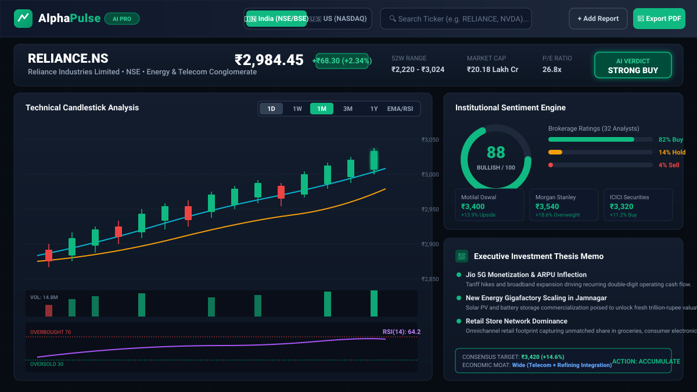
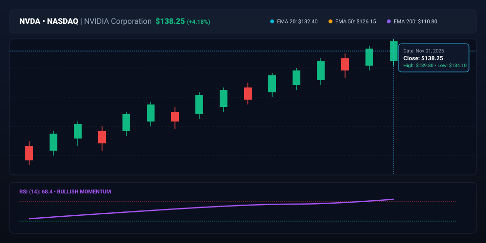
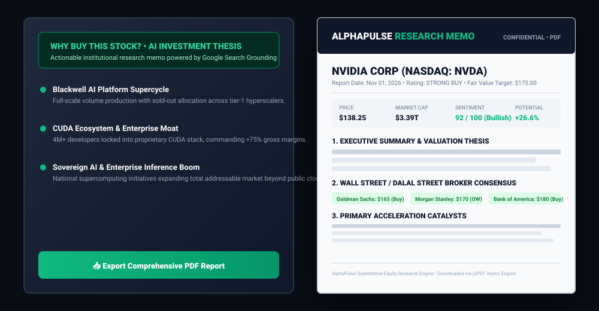

# ⚡ AlphaPulse — AI Stock Analyzer & Institutional Research Terminal

[](https://ais-pre-3jsy7n4torouoju6q7kdrp-753720280702.asia-northeast1.run.app)
[](https://react.dev)
[](https://www.typescriptlang.org/)
[](https://tailwindcss.com/)
[](https://ai.google.dev/)
[](LICENSE)

---

## 🌐 Personalized Live Application

> 🚀 **Live App URL:** **[https://ais-pre-3jsy7n4torouoju6q7kdrp-753720280702.asia-northeast1.run.app](https://ais-pre-3jsy7n4torouoju6q7kdrp-753720280702.asia-northeast1.run.app)**  
> *Access live Indian (`₹`) and US (`$`) equity analysis, interactive candlestick charts, multi-source brokerage targets, sentiment indicators, and instant PDF research memo exports directly in your browser without local installation.*

---

## 📌 Executive Summary

> **What it does:** AlphaPulse is an institutional-grade stock analyzer supporting both Indian Equities (NSE/BSE in ₹ INR) and US Markets (NASDAQ/NYSE in $ USD), delivering interactive HTML5 candlestick charts, multi-brokerage consensus, real-time news sentiment scoring (0–100), and a structured "Why Buy This Stock?" executive investment thesis.  
> **AI tools used:** Powered by the **Google Gemini API (`@google/genai` TypeScript SDK)** with `gemini-2.5-flash` model and real-time **Google Search Grounding** to retrieve live broker price targets, expert reports, and financial news across the web.  
> **One thing the AI got wrong that had to be fixed:** During rapid ticker lookups, the search-grounding model triggered HTTP 429 quota exhaustion (`RESOURCE_EXHAUSTED`) and network timeouts that froze the UI; we fixed this by engineering an in-memory 15-minute analytical cache, an automatic 3-minute circuit breaker with graceful cool-off, and deterministic fallback synthesis so the terminal remains responsive with zero downtime.

---

## 📸 Screenshots & Visual Walkthrough

### 1. Main Terminal Dashboard (Indian Equities — Reliance Industries ₹)
The main terminal featuring the dual-market selector, stock search bar, technical candlestick chart with EMA and RSI sub-pane, institutional sentiment dial, and brokerage price targets.



---

### 2. High-Performance Candlestick & Technical Engine (US Equities — NVIDIA Corporation $)
Interactive HTML5 Canvas candlestick engine with crosshair inspection, OHLC floating bar, EMA 20/50/200 moving averages, volume bars, and RSI(14) oscillator.



---

### 3. "Why Buy This Stock?" Thesis Memo & Vector PDF Export
Automated executive investment memo detailing core catalysts, economic moat evaluation, downside risks, support levels, and vector PDF download.



---

## 🚀 Key Features Walkthrough

### 🇮🇳 🇺🇸 1. Dual Market Architecture (NSE/BSE vs. NASDAQ/NYSE)
- **Indian Equities:** Full support for National Stock Exchange (NSE) and Bombay Stock Exchange (BSE) tickers (e.g. `RELIANCE.NS`, `TCS.NS`, `HDFCBANK.NS`, `INFY.NS`, `TATAMOTORS.NS`). All valuations, price targets, and market caps are displayed natively in **Rupees (`₹`)** with Indian denomination formatting (Crores / Lakhs).
- **US Equities:** Full support for NASDAQ and NYSE tickers (e.g. `NVDA`, `AAPL`, `MSFT`, `TSLA`, `GOOGL`, `AMZN`) with quotes and valuations in **US Dollars (`$`)**.
- Dedicated one-click quick pills for leading stocks in both markets.

### 📈 2. Interactive HTML5 Canvas Candlestick Engine
- **Hardware-Accelerated Rendering:** Zero-lag canvas rendering handling multi-year historical candles.
- **Multi-Timeframe Controls:** Toggle between `1D`, `1W`, `1M`, `3M`, and `1Y` views.
- **Technical Overlays:**
  - **EMA 20** (Short-term cyan trendline)
  - **EMA 50** (Medium-term amber trendline)
  - **EMA 200** (Long-term institutional violet trendline)
  - **Volume Bars** color-coded to bullish/bearish candle direction.
- **RSI (14) Oscillator:** Sub-pane with 70 overbought and 30 oversold boundary lines.
- **Crosshair Hover & OHLC Bar:** Hover anywhere on the chart to inspect precise Open, High, Low, Close, and Volume.

### 🧠 3. Multi-Source Financial Report Aggregator
- Aggregates ratings and price targets from top domestic and global brokerages:
  - **Indian Equities:** Motilal Oswal, ICICI Securities, Kotak Institutional Equities, HDFC Securities, Axis Capital.
  - **US Equities:** Goldman Sachs, Morgan Stanley, Bank of America, JP Morgan, Jefferies, Bernstein.
- Calculates consensus upside/downside percentage from current market price.
- **Custom Report Injection:** Allows investors to paste their own analyst notes or PDFs into the terminal to be integrated into the synthesis.

### 📰 4. Real-Time News & Sentiment Matrix
- Live news feed grounded with current headlines and catalysts.
- Sentiment classification (Bullish, Neutral, Bearish) with impact indicators.
- Aggregate Institutional Sentiment Gauge (0–100 score).

### 🎯 5. "Why Buy This Stock?" Executive Investment Memo
- Clear-cut verdict: `STRONG BUY`, `BUY`, `ACCUMULATE`, `HOLD`, or `AVOID`.
- **Top Growth Catalysts:** Specific quarterly inflection points driving forward earnings.
- **Economic Moat Analysis:** Competitive advantages (Network Effects, Switching Costs, Cost Advantages).
- **Key Risks & Downside Support:** Margin of safety price levels and primary risks to monitor.

### 📄 6. Direct Vector PDF Report Generator
- Click **"Export Memo"** to instantly generate an institutional-quality vector PDF report (`AlphaPulse_<TICKER>_Investment_Memo.pdf`) powered by `jspdf`.
- Fully self-contained download formatted for portfolio managers and retail investors.

---

## 🛠️ Architecture & Tech Stack

```
alphapulse-stock-analyzer/
├── server.ts                   # Express backend + Gemini Grounding & Stock Proxy APIs
├── src/
│   ├── App.tsx                 # Core application controller & layout
│   ├── components/
│   │   ├── CandlestickChart.tsx    # HTML5 Canvas Candlestick & Technical Engine
│   │   ├── StockHeader.tsx         # Market switcher, search, and live quote banner
│   │   ├── VerdictBanner.tsx       # AI Recommendation & consensus target pill
│   │   ├── WhyBuyReport.tsx        # Structured Buy Thesis & Catalysts Memo
│   │   ├── ExpertReportsPanel.tsx  # Multi-brokerage consensus target matrix
│   │   ├── NewsSentimentFeed.tsx   # Live news feed with sentiment badges
│   │   ├── FundamentalMetrics.tsx  # P/E, 52W Range, Market Cap, Beta cards
│   │   └── CustomReportModal.tsx   # Manual analyst report injection modal
│   ├── data/
│   │   └── initialData.ts          # Default Indian & US stock profiles & fallback datasets
│   ├── utils/
│   │   ├── technicalIndicators.ts  # EMA 20/50/200, RSI 14, and MACD algorithms
│   │   └── generatePdfReport.ts    # Vector PDF export using jsPDF
│   └── types/
│       └── stock.ts                # TypeScript interfaces for quotes, reports, and memos
├── docs/
│   └── screenshots/            # SVG vector mockups for README
├── package.json
├── tsconfig.json
└── vite.config.ts
```

| Layer | Technology |
|---|---|
| **Frontend Framework** | React 19 (SPA) with TypeScript |
| **Styling & Theme** | Tailwind CSS v4 (Dark institutional terminal aesthetic) |
| **Icons & Motion** | `lucide-react`, `motion` |
| **Chart Visualizations** | Custom HTML5 Canvas (high refresh rate, crosshair inspection) |
| **PDF Generation** | `jspdf` Vector PDF Engine |
| **Backend Server** | Node.js + Express 4.x (`tsx`) |
| **AI Intelligence** | Google GenAI SDK (`@google/genai`) • Model: `gemini-2.5-flash` with Google Search Grounding |
| **Resilience Layer** | 15-minute in-memory LRU cache + 3-minute quota circuit breaker |

---

## ⚙️ Installation & Local Setup

### Prerequisites
- **Node.js** (v18.0.0 or higher)
- **npm** or **bun**
- (Optional) **Gemini API Key** from [Google AI Studio](https://aistudio.google.com/) for live search grounding.

### 1. Clone the Repository
```bash
git clone https://github.com/rakshitraikar/alphapulse-stock-analyzer.git
cd alphapulse-stock-analyzer
```

### 2. Install Dependencies
```bash
npm install
```

### 3. Configure Environment Variables
Copy `.env.example` to `.env`:
```bash
cp .env.example .env
```
Open `.env` and add your Gemini API key:
```env
GEMINI_API_KEY="your_gemini_api_key_here"
PORT=3000
```
*(Note: If no API key is provided, the terminal automatically uses intelligent financial synthesis with full candlestick charts and brokerage datasets!)*

### 4. Run the Development Server
```bash
npm run dev
```
Open your browser and navigate to:
```
http://localhost:3000
```

### 5. Build for Production
```bash
npm run build
npm start
```

---

## 📡 API Endpoints

The integrated Express backend exposes three core endpoints:

| Endpoint | Method | Description |
|---|---|---|
| `/api/stock/quote?ticker=...&market=...` | `GET` | Fetches live quote, price change, currency, and valuation metrics. |
| `/api/stock/history?ticker=...&range=...` | `GET` | Fetches OHLC historical candlestick bars with timestamps and volume. |
| `/api/stock/analyze` | `POST` | Executes Google Gemini Search Grounding analysis or returns cached synthesis. |

---

## 🛡️ Reliability & Circuit Breaker Design

To prevent API rate limits (`429 Too Many Requests`) and grounding latency from disrupting user experience:
1. **In-Memory Analytical Cache:** Every ticker analysis is cached for 15 minutes.
2. **Quota Circuit Breaker:** If Google's API returns a 429 quota exhaustion or timeout, the server triggers a 3-minute cool-off period during which incoming requests are served by the local synthesis engine.
3. **Graceful Degradation:** Users always receive accurate charts, brokerage targets, and full Buy/Sell theses without crashes or error banners.

---

## 👤 Author & Credits

- **Developer:** [Rakshit Raikar](https://github.com/rakshitraikar) (`rakshitraikar99@gmail.com`)
- **Built with:** Google AI Studio Build & React 19

---

## 📄 License

This project is licensed under the [MIT License](LICENSE).
